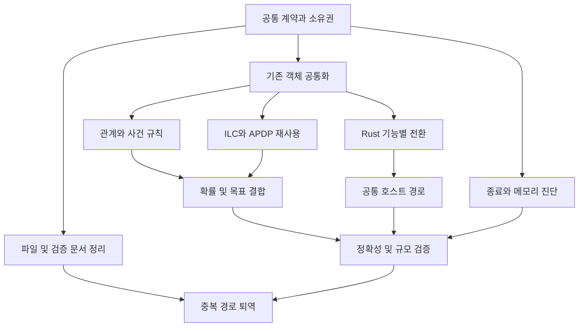

# Clearra: Rust 코어 통합과 의존성 기반 탐색의 실행 계획

작성일: 2026-11-20 KST

조사 기준: `prototype/placement-dependency-20261120`, `caacfae0c9958949858bb846f2bb52eb5fcbb50d`

상태: **기획 문서. 구현·리팩터링·삭제·새 벤치마크를 실행하지 않았다.**

## 1. 결정과 우선순위

이번 작업의 중심은 **정확한 배치 관계를 만드는 데 필요한 계산 자체를 줄이고, 그 결과를 ILC → 타일링 → 조건·확률 계산까지 재사용하는 것**이다. 도달성 호출 한 번의 상수 비용을 줄이는 것만으로 성공을 판정하지 않는다. 관계를 만들기 위해 기존 BuildUp과 비슷한 수의 배치 순서를 다시 탐색한다면 목표를 달성하지 못한 것이다.

그 위에 프로젝트 소유 탐색 코어를 Rust로 통합한다. 이미 구현된 Rust CPU 탐색을 공통 엔진으로 발전시키며, 기존 Rust 구현을 조사하지 않은 채 C를 다시 옮긴 세 번째 엔진을 만들지 않는다. 요청·프로필·카탈로그·워커·결과의 실제 소유권을 명확히 하여 중복 생성과 불필요한 장기 보유를 줄인다.

우선순위는 다음과 같다.

1. 정확성 계약, 실행 경로, 공유 객체의 소유자를 고정한다.
2. 모든 미노에 적용하는 support OR·줄 삭제 사건·무관한 관계의 조기 제외부터 구현한다.
3. 기존 ILC·APDP·family의 반복 계산을 재사용·증분 전파로 줄인다.
4. 같은 Rust 코어를 native/WASM/제품 서비스에서 사용하도록 기능 격차를 닫는다.
5. 완전한 관계와 공급을 결합하여 개별 큐·물리 배치 순서 열거가 필요 없는 요청의 비용을 줄인다.
6. 증거가 확보된 기능부터 C 구현과 중복 wrapper를 퇴역시키고, 책임별 모듈 구조를 정리한다.

2·3·4는 공통 계약이 정해진 뒤 병렬로 진행할 수 있다. **C 전환이 끝날 때까지 관계 알고리즘 개선을 미루지 않는다.** 대규모 파일 이동도 알고리즘 작업 전체의 선행조건으로 만들지 않는다.

사용자의 Sfinder 9→10미노 설명은 실용적인 탐색 비용 급증에 관한 관측으로 이해한다. 불가능성 정리로 해석하지 않는다. 이 계획은 다른 도구와의 무조건적인 성능 우위를 주장하지 않으며, Clearra 내부의 동일 결과 계약에서 병목을 줄이는 것을 목표로 한다.

## 2. 조사에서 확인한 현재 상태

### 2.1 C와 Rust의 실구현이 함께 존재한다

`core-c/cmake/source_manifest.cmake`는 board, rule, supply, ILC/geometry, APDP, packing, reachability, BuildUp, coverage, memory를 실제 C 빌드에 연결한다. Git 추적 C 소스는 183개, 헤더는 102개로 합계 285개이며 모두 `core-c/` 아래에 있다. 작은 잔여 wrapper 몇 개만 옮기는 작업은 아니다.

동시에 `clearra-core-executor/src/backend/wasm_cpu/`에는 Rust의 geometry/ILC/APDP/BuildUp/reachability/coverage/확률 경로가 있다. `WasmCpuSearchBackend`라는 이름과 달리 native에서도 실행된다. `AppCoreExecutorBackend`에는 `NativeCore`와 `WasmCpu`가 따로 있으며, CLI의 `wasm-cpu-runtime` feature에 따라 선택도 달라진다.

두 경로의 기능은 아직 동등하지 않다. 예를 들어 `app_services.rs`의 NativeCore는 execution constraints 및 supplied-solution identity filter를 거절하는 분기가 있고, Rust 서비스의 기존 `execute_build_coverage_with_control` 진입점에는 미연결 오류가 있다. 따라서 backend 이름이나 enum 분기만 바꾸어 전환을 완료할 수 없다. 제품 요청별 실제 지원 범위를 먼저 확정한다. [S1]

### 2.2 이미 있는 구조를 새로 만들지 않는다

| 현재 기반 | 실제 소유자·심볼 | 계획에서의 역할 |
| --- | --- | --- |
| 미노 형상·프로필 | `clearra-piece-registry`, `clearra-rules` | 형상·ordered kick의 유일한 의미 원천 |
| ILC realization·skeleton | `catalog.rs::GeometryCatalog` | 구체 배치 ID와 realization의 공통 소유자 |
| 행 좌표 변환 | `row_frame.rs::CompactedRowFrame` | 기존 원래 행↔물리 행 대응 재사용; 제한된 wrapper 계약 보존 |
| 투영 선행 필터 | `inverse_projection.rs::ProjectionRowFilter` | 기존 필터 재사용; 같은 최적화를 새로 만들지 않음 |
| 삭제 행별 실현 | `compile_instantiation_table`, `instantiations` | 정확한 frame-domain의 권위로 정리 |
| cell→placement incidence | `GeometryCatalog::support` | 무관한 관계를 열거 전에 제외하는 출발점 |
| 정확한 APDP 부모 | `geometry_apdp.rs::ExactArmPairIndex` | partial별 full parent 대안 보존 |
| residual 재사용 | `geometry.rs::ResidualMemo` | 같은 잔여 기하 문제의 기존 재사용 유지 |
| completion 재사용 | `geometry.rs::GeometryCompletionOracle` | before/after-clear compiler와 available-row cache 재사용 |
| 타일링 family | `geometry_family.rs::GeometrySolutionFamily` | `Append/Union/Product` 및 공유 suffix 활용 |
| projection·component | `geometry_projection.rs`, `geometry_component.rs`, `geometry_separator.rs` | 기존 기하학적 증명 재사용; 이동 독립성과 혼동하지 않음 |
| 공급·coverage | `clearra-supply`, `clearra-coverage` 및 기존 확률 경로 | hold·가중치·큐 합집합 의미 유지 |

확인한 중복은 다음과 같다.

- `PlacementConditionCatalog`는 카탈로그의 모든 삭제 행 상태를 다시 조회하여 정확한 domain을 만들고 cell incidence를 복제한다. 소비자에게 필요한 view를 제공하는 단일 소유자가 후보이다.
- `normalized_kick_delta`와 `normalized_rotation_center`가 일반 reachability, extended reachability, finesse에 각각 존재한다. 의미가 같은 이 정의부터 공통화할 수 있다.
- C FFI의 `CoreContext = ContractCoreContext`와 실제 C 메모리를 감싼 `NativeCoreContext`가 공존한다. 이름이 아닌 실제 호출 경로와 수명을 기준으로 책임을 정리한다. [S2][S3]

`clearra-exact-cover`의 현재 `solve_first` 중심 solver와 ILC 전체 family compiler는 계약이 다르다. `clearra-geometry`의 정적 placement 열거도 stretched target-frame ILC를 자동 대체하지 않는다. **기존 코어를 우선 검토하되, 의미가 같은 부분만 재사용한다.**

`CompactedRowFrame`은 이미 행 대응의 단일 소유자이고 `LocalRelationRowFrame`은 이를 감싸 더 좁은 범위를 허용한다. 이 wrapper를 중복으로 지우지 않는다. 현재 일부 변환은 폭 10·높이 1~6이라는 계약을 가지므로, extended 지원은 새 변환기를 복제하지 않고 범위별 일반화 가능성을 검증한다. `ProjectionCatalog`도 compact/extended 입력을 `compile_projected`로 합치는 기존 재사용 사례다. [S10]

### 2.3 APDP 적용 범위와 메모리 문제를 구분한다

현재 `FamilyCompiler::advance`에서 고급 domain 전파는 `!resource_authoritative`, 목표 깊이 7 이상, 비어 있지 않은 초기 필드라는 조건을 갖는다. 빈 필드 P7P4는 `compile_minimum`을 사용한다. APDP 자체의 개선을 빈 P7P4 개선이라고 보고하지 않는다. 활성 범위를 넓히는 작업은 정확성·자원 계약·손익을 검증하는 별도 과제다. [S4]

최근 P7P4 미완료 실행 세 번은 Rust 백엔드의 native 실행에서 발생했다. 종료 137/SIGKILL, 빈 결과 JSON, 표본 RSS 최대 약 4.64~4.74 GB라는 기록은 있으나, 커널 OOM 또는 외부 종료 중 어느 쪽인지는 확정하지 못했다. `runtime.rs`의 `status.code().unwrap_or(125)`가 Unix 종료 신호를 잃는 진단 문제는 소스에서 확인했다. **Rust 전환을 이 종료 문제의 검증된 해결책으로 취급하지 않는다.** [S5]

### 2.4 파일 수는 소스와 산출물을 나눠 관리한다

조사 기준 Git 추적 파일은 **4,211개**, `.rs` 파일은 **2,403개**, `tools/vendor/`를 제외한 자체 Rust 파일은 **2,264개**다. 사용자의 다른 작업환경에서 수만 개가 보이는 상황과 이 스냅샷의 수치를 동일시하지 않는다. 빌드·의존성 산출물의 수는 소스 모듈 수와 별도로 집계한다.

파일 수 감소의 우선 수단은 중복 엔진·중복 adapter·불필요한 호환 shim의 퇴역과 응집도 회복이다. 파일을 합쳐 숫자만 줄이거나 하나의 타입마다 새 파일·새 crate를 만드는 것을 목표로 삼지 않는다. 상세 기준은 10절에 둔다.

| Git 추적 경로 | 파일 수 |
| --- | ---: |
| `crates/` | 2,287 |
| `scripts/` | 561 |
| `core-c/` | 293 |
| `packages/` | 273 |
| `apps/` | 244 |
| `tools/` | 193 |
| `tests/` | 162 |
| `docs/` | 142 |
| 나머지 설정·자산·루트 파일 | 56 |
| 합계 | 4,211 |

자체 Rust에서 `tests/`, `benches/`, `examples/`, `_tests.rs`, `tests.rs`를 제외한 계획용 분류는 1,862개 파일이다. 이 중 100줄 이하 981개, 1,000줄 초과 118개이며, 인라인 테스트는 포함된다. 이 수치는 과분할·SRP 위반의 판정이 아니라 조사 우선순위다. `mod.rs` 같은 정상적인 작은 연결 모듈도 포함된다.

큰 파일의 예는 `exact_minimum_cover.rs` 12,238줄, `build_probability.rs` 8,248줄, `desktop_request_bridge.rs` 7,608줄, `result.rs` 7,376줄, `buildup.rs` 5,338줄이다. 줄 수는 빈 줄·주석·인라인 테스트를 포함한다. 반면 `clearra-app`의 `request.rs`·`response.rs`는 각각 4줄, `run_request.rs`는 5줄이다. 양쪽 모두 실제 책임과 호환성부터 확인한다. [S11]

## 3. 모든 작업자가 지켜야 하는 계약

아래 내용은 작업 배정과 다른 세션 인계 시 그대로 전달한다. 후속 담당자가 일부 성능 항목만 읽고 방향을 바꾸지 않도록 각 작업의 완료 조건에도 적용한다.

1. **ILC·APDP에서는 반복 연산을 제거하는 재사용·증분 처리·알고리즘 개선만 다룬다.** 자료구조 패킹, 비트폭, padding, 해시 컨테이너 교체, cache-line, SIMD, 작은 할당 상수 최적화는 이 트랙의 검토·성과 범위 밖이다. 35비트 전용 공급 표현도 우선 과제에 포함하지 않는다.
2. 관계 구성 비용과 구성 중 physical reachability 호출 수를 먼저 측정한다. BFS를 전처리·predicate 내부로 옮겨 비용이 사라진 것처럼 보고하지 않는다.
3. 동일 kind의 서로 다른 구체 placement/parent는 다른 ID다. 선택 여부, 실행 여부, 현재/hold 공급 발생은 서로 다른 의미다.
4. 조건의 OR, 부정, parent 대안과 frame의 상관관계를 보존한다. 단순 DAG 또는 선행자 집합 교집합으로 모든 관계를 대신하지 않는다.
5. kick first-success 순서, 동시 줄 삭제, 원래 행과 물리 행의 좌표 계약을 보존한다. 최대 kick 거리만으로 전체 영향 반경을 단정하지 않는다.
6. 필요한 조건만 확인한 결과를 충분조건으로 쓰지 않는다. Unknown·미지원·자원 부족은 Impossible이 아니다. 불완전 실행을 완전한 확률로 출력하지 않는다.
7. 새 객체·crate·캐시를 만들기 전에 기존 소유자와 재사용하지 못하는 구체적인 이유를 제시한다. digest 일치는 의미 동등성 증명이 아니다.
8. 생산 Rust 코어는 하나로 수렴한다. 검증용 독립 oracle과 명시적인 compact/extended 특수화는 유지할 수 있다.
9. CountUnique, CountAll, hold 분기 다중성, 큐 universe·가중치, 해별/전체 coverage, terminal evidence와 completeness를 각각 검증한다.
10. 워커는 환경의 자동 논리 프로세서 수를 유지한다. 자원 정책이나 워커 수를 줄여 실패를 숨기지 않는다. 큰 벤치마크는 manager 아래에서 순차 실행한다.
11. 원시 실행 기록은 `_local/artifacts/`, 검토한 해석은 `docs/research/`에 둔다. 코드 이동·성능 변경·정책 변경을 한 변경에 섞지 않는다.
12. 이번 문서는 구현 완료 기록이 아니다. 아래 체크리스트는 후속 구현과 검증을 통과해야 완료 처리한다.

## 4. 목표 구조와 객체의 책임

객체화의 기준은 **하나의 의미, 그 의미의 불변식, 필요한 데이터의 수명, 제한된 변경 경로**다. 클래스 수나 trait 수를 늘리는 것이 아니다. 다음은 개념적 역할이며 각 행을 새 crate나 새 파일로 만들라는 요구가 아니다.

| 역할 | 기존 소유자 우선 | 소유해야 할 내용 | 소유하지 않을 내용 |
| --- | --- | --- | --- |
| 규칙·형상 정의 | `clearra-rules`, `clearra-piece-registry` | ordered kick, 정규화 좌표, capability | 후보별 배치 상태 |
| 요청 계약 | `clearra-problem`, `clearra-core-domain` | 보드·목표·공급·ID·완료 상태 | ABI 포인터, UI 상태 |
| 불변 기하 카탈로그 | 기존 Rust `GeometryCatalog` | realization, exact frame-domain, incidence, APDP parent | queue cursor, hold, 장기 누적 결과 |
| 타일링 family | 기존 `GeometrySolutionFamily` | 기하학적 대안과 suffix 공유 | 증명 없는 이동 독립성 |
| 관계 compiler | 기존 placement/structural 모듈 정리 | support·movement·clear·terminal-label 조건 | 숨은 순차 BuildUp |
| 공급·목표 결합 | 기존 supply/language/coverage 경로 | 큐 합집합, 가중치, hold, 목표 상태 전이 | 새로운 물리 도달성 구현 |
| 워커 workspace | 기존 BuildUp/reachability workspace | 해당 워커의 가변 scratch와 짧은 binding | 요청 전체 불변 데이터의 깊은 복제 |
| 결과·증거 | 기존 result/replay/coverage 객체 | 요청한 결과와 필요한 재생 증거 | 사용이 끝난 전체 중간 그래프 |
| 제품 orchestration | `clearra-app` | 계약 검증과 서비스 연결 | 두 번째 solver |
| 호스트 adapter | CLI, Web, Discord, desktop | 수송·스케줄링·표시 | 별도 미노/확률 규칙 |
| ABI adapter | `clearra-core-ffi`의 축소된 경계 | 확인된 외부 호환 계약 | 도메인의 원천 정의 |

`SearchSession`과 같은 수명 소유자는 기존 요청 객체에 대응시키는 설계 이름으로 사용한다. API를 새로 만들기 전에 기존 session/workspace가 같은 책임을 이미 갖는지 확인한다. 불변 카탈로그는 요청 단위로 공유하고, worker scratch는 worker가 소유하며, candidate relation binding은 소비가 끝나면 해제한다.

동일 shape와 rule 의미는 함께 쓴다. Board64와 extended board의 실행 커널은 능력·비용 차이가 있으면 특수화를 남긴다. 모든 것을 하나의 거대한 generic 함수로 합치는 것도, 호스트마다 전체 알고리즘을 복제하는 것도 피한다.

## 5. 관계 알고리즘: 무엇을 미리 만들고 무엇을 생략할 것인가

### 5.1 관계의 기본 단위

타일링 선택 변수 `s_p`와 이미 배치한 변수 `x_p`를 구분한다. 삭제된 원래 행 집합을 `D`, ordered kick 프로필을 `K`라고 할 때 목표 배치 `q`의 조건을 다음처럼 분해한다.

\[
Enabled_q = \neg x_q \land Selected_q \land Frame_q(D)
             \land Support_q(X,D) \land Entry_q(X,D,K).
\]

위 식은 최종 데이터구조를 미리 고정한 것이 아니다. 각 인자가 무엇을 증명하는지 분리하여 같은 의미를 재계산하지 않기 위한 계약이다. 지원하는 범위에서 완성된 관계의 실행 언어는 물리 실행 언어와 양방향으로 같아야 한다.

\[
\mathcal L_{relation}=\mathcal L_{physical}.
\]

순수 AND 선행조건만 남는 경우에는 기존 poset 경로를 재사용한다. 일반적인 OR·부정·조건부 clear 사건에는 조건식 또는 사건 hypergraph가 필요하다. 표현을 바꾸었다고 최악의 경우의 지수적 복잡도가 없어지는 것은 아니다. 공통 부분, 독립 부분, 반복 경계의 계산을 제거하는 것이 실질적인 목표다.

### 5.2 바닥과 supporter OR를 가장 먼저 처리한다

현재 물리 frame에서 목표 셀 집합을 `P_q^D`라 하면 아래쪽 외곽 `F_q^D`가 받침 검사 대상이다.

\[
F_q^D=Down(P_q^D)\setminus P_q^D,
\quad Support_q=floor\lor initialSupport\lor\bigvee_p(x_p\land Supports(p,q,D)).
\]

Z가 L 또는 S 위에서 멈출 수 있다면 조건은 `x_L OR x_S`다. 이를 L과 S 모두 필요하다는 두 개의 필수 선행 간선으로 바꾸지 않는다. 현재 BuildUp에도 grounding 검사가 있으므로 중복 검사를 추가하는 것이 핵심이 아니다. **타일링 이전에 supporter 대안을 만들고, 관계 구성·부분 타일링에서 재사용**하는 것이 변경점이다.

부분 타일링에서는 아직 선택할 수 있는 호환 parent와 허용 frame을 고려한다. 현재 선택한 조각 중 받침이 없다는 이유만으로 prune하지 않는다. 모든 미래 대안에서도 support가 불가능할 때만 제거한다.

### 5.3 무관한 관계를 생성하지 않는다

먼저 모든 미노 쌍을 만들고 값비싼 검사로 지우는 방식보다, 기존 cell incidence를 통해 증명에 필요한 셀의 owner만 가져온다.

1. 규칙·목표·frame에 유효한 영향 범위를 얻는다.
2. 그 범위와 만나는 concrete placement 후보만 찾는다.
3. 변하지 않는 점유, 이미 결정된 분기, 닫힌 분리 경계로 불필요한 변수를 제거한다.
4. 여전히 영향을 줄 수 있는 관계만 조건식에 남긴다.

범위가 겹친다는 것은 관계 후보라는 뜻이다. 실제 의존성이 있다는 증명과 다르다. 반대로 단독 A/B 비교만으로 보편적인 무관함을 증명할 수도 없다. A와 B가 서로 다른 진입로를 각각 막아 함께 있을 때만 실패하는 반례를 포함한다.

O의 행 단조 계산은 검증된 특수 규칙으로 유지한다. 다른 미노에는 ordered kick 분기 조건을 적용한다. j번째 kick이 선택되려면 다음 조건이 필요하다.

\[
Chosen_j=Free(t_j)\land\bigwedge_{i<j}\neg Free(t_i).
\]

장애물 제거가 앞선 kick을 성공시켜 원하는 뒤쪽 kick을 선택하지 못하게 할 수 있다. 따라서 O의 단조성을 모든 미노로 확장하지 않는다. 하드드롭·열린 진입 경로·불변 kick prefix·닫힌 통로 분리·증명된 이동 성분 등을 독립 규칙으로 일반화한다. 하드드롭 성공은 충분조건이지만 실패는 전체 배치 불가능의 증명이 아니다.

현재의 정적 influence mask는 보조 수단이다. 이것을 만드는 pose topology 순회까지 후보마다 반복한다면 주목표에 어긋난다. 규칙 형태를 공유하고, 해당 범위가 전체 필드가 되는 어려운 사례는 정직하게 남긴다.

### 5.4 줄 삭제는 별도 사건이지만 자동으로 발생한다

원래 행 r의 빈칸을 채우는 concrete contributors를 `C_r`라 하면, 초기 완성 행 처리 계약을 정규화한 뒤 행 완성 조건은 `AND_{p in C_r} x_p`로 표현한다. O가 S의 이동을 직접 막지 않고 줄 삭제를 통해서만 영향을 준다면 다음 관계로 보존한다.

`O 및 다른 contributors → 행 완성 → 동시 삭제 사건 ΔD → S의 새 frame 조건`.

줄 삭제는 플레이어가 임의로 선택하거나 지연하는 사건이 아니다. lock 직후 완성된 모든 행을 한 사건으로 삭제한다. 지워진 미노의 일부 셀은 남아 충돌에 영향을 줄 수 있으므로, 이미 실행된 미노에 pending placement의 ILC domain을 잘못 적용하지 않는다.

tetromino 하나가 새로 완성할 수 있는 원래 행은 최대 네 개다. 이는 국소 사건 분류의 작은 상한이며, 전체 관계 상태가 16개뿐이라는 주장이 아니다. 행 contributor와 이동 영향 관계를 분리하면 직접 영향이 없는 미노를 이동 조건에서 제외하면서도 간접 효과는 정확하게 남길 수 있다.

### 5.5 B2B와 다른 목표 조건

기존 B2B-save 정책은 0줄, 4줄, PC, 또는 인정되는 spin을 허용한다. 숫자 B2B chain의 갱신 규칙은 별개다. PC 예외를 chain 증가 규칙으로 혼동하지 않는다. [S6]

관계는 배치 가능성뿐 아니라 lock/clear의 최소 terminal evidence를 낸다. 목표별 상태 기계가 그 evidence를 소비하도록 한다. B2B-save만 요청한 0줄·4줄·PC 전이에서 불필요한 spin evidence를 만들지 않는 기회를 검토한다. 1~3줄·non-PC에서 T-only 프로필의 non-T 전이를 조기에 제외하는 것은 해당 정책의 정확한 적용 범위 안에서만 허용한다.

`core-executor → scoring`의 직접 runtime 의존성을 새로 추가하지 않는다. 기존 정책을 복사하지 않고, 제품 계층이 준비한 중립적인 goal/event 계약을 relation evaluator에 전달하는 방향으로 경계를 설계한다. 현재 runtime에서 `clearra_postprocess::BackToBackEdgePolicy`를 거치는 경로도 조사·정리 대상이다. 순수 목표 정책과 물리 terminal evidence를 분리하되 정책의 의미 권위는 하나로 유지한다.

CountAll이 요구하지 않는 한 동일 배치의 여러 terminal 증거가 결과 수를 늘리면 안 된다. 순서 교환도 물리 관계, 삭제 사건, 목표 상태, 공급 계약을 모두 보존할 때만 허용한다.

### 5.6 수동 CEGIS 방식의 발전

반례 기록은 두 종류로 구분한다. 첫째는 실제 허용/불허·확률이 잘못된 의미 반례, 둘째는 정답이지만 관계 완성에 탐색이 많이 필요한 비용 반례다.

각 사례에서 관련 placement, row 사건, kick prefix를 최소화한다. 그다음 여러 사례를 포괄하는 규칙을 만들고 적용 범위를 증명한다. 기존 작은 물리 oracle과 제품 계약으로 검증한 뒤, residual 검색이 얼마나 제거됐는지 측정한다. 유한 테스트에서 반례가 없었다는 사실을 모든 필드의 증명으로 승격하지 않는다.

개발 중에는 기존 정확 BuildUp을 비교·fallback으로 사용할 수 있다. 하지만 fallback이 남은 비율과 비용을 공개해야 하며, 모든 대상 관계가 완성됐다고 선언할 때는 predicate 내부에 물리 탐색을 숨길 수 없다. 일반화가 아직 안 된 범위는 범위별 미완성으로 남긴다.

## 6. ILC·APDP의 구조적 최적화

### 6.1 ILC: 정확한 frame-domain을 한 번 정의한다

`required_deleted_rows`, occupied rows, skeleton requirement domains, 정확한 instantiation table, placement의 exact clear domain은 서로 관련되지만 같은 강도의 증거가 아니다. 필요한 삭제 행 조건만으로 정확한 실현 가능성을 대체하면 안 된다.

먼저 `RowFrame → RealizationDomain → PlacementDomain`의 의미를 한 소유자에서 정의하고 각 소비자에게 필요한 view를 준다. 기존 incidence도 복제 생성보다 소유자 참조를 우선한다. 지원 범위가 다르거나 생명주기가 달라 복사해야 하는 경우에는 이유와 보유 비용을 남긴다.

그다음 다음 후보를 검토한다.

- 같은 shape·row assignment·frame의 투영을 재계산하지 않는 공유 단위.
- 실제 소비되는 frame에 한정한 정확 instantiation과 이미 계산된 결과의 재사용.
- 필요한 삭제 행, 자기 행 삭제 금지, 정확 투영 조건을 합성한 기호적 domain. 높이에 따른 모든 D 열거를 줄일 가능성이 있으나 **필요충분성은 아직 증명 과제**다.
- before-clear와 after-clear compile domain을 구별한 증분 재투영.
- compact/extended가 같은 투영 의미를 공유하되 용량·지원 범위는 보존하는 공통화.

삭제 이후 영향받는 범위에는 삭제 행 주변뿐 아니라 그 위에서 이동한 surviving cells·미래 배치·support·kick 조건도 포함한다. 이전 frame의 무영향 증명은 새 frame에서도 전제가 보존되는지 확인했을 때만 재사용한다.

캐시를 추가하는 것 자체가 성과가 아니다. 새로 유도한 realization 수, exact-domain 평가 수, raw instantiation 수가 줄었는지 확인한다. 폭·높이·shape·profile·초기 필드·domain 정책 중 결과에 영향을 주는 요소를 공유 key에서 빠뜨리지 않는다.

### 6.2 APDP: 변화한 parent만 다시 전파한다

현재 residual memo는 동일 잔여 상태를 재사용한다. 새로운 후보는 **부모와 자식 residual 사이에서 바뀌지 않은 지원 도메인 검사를 생략**하는 것이다.

placement가 선택되면 겹치는 full parent가 제거된다. 공급 가능한 kind가 바뀌면 그 kind의 parent가 달라진다. 영향받은 cell/partial만 갱신하고, SameTile·common owner·APDP 증거를 정확히 무효화하여 다시 전파한다. 되돌리기는 해당 branch에서 바뀐 의미 상태를 복구한다. full compile 결과를 oracle로 하여 모든 분기의 살아 있는 parent 집합을 비교한다.

APDP parent 대안과 frame을 유지한 관계 조각은 다음 형태다.

\[
\bigvee_{p\in Parents(a)}
 (Selected_p\land FrameDomain_p\land RelationFragment_p).
\]

어떤 parent에서 L support가 가능하고 다른 parent에서 S support가 가능한 것을, L과 S가 동시에 존재하는 하나의 상태로 합치지 않는다. static-exact APDP 범위를 우선 사용하고 temporal APDP는 별도 연구·증명 이후 확대한다.

### 6.3 기존 family에 결합하되 prefix 의존성을 숨기지 않는다

기존 `Append`에는 새 placement가 바꾸는 관계만, `Union`에는 각 대안의 상관관계, `Product`에는 실제 component 경계 조건을 결합한다. 완성 타일링마다 관계를 처음부터 만들지 않는 방향이다.

다만 geometry의 residual key가 같아도 선택한 prefix의 concrete placements, row contributors, 진입 통로는 다를 수 있다. **family ID만으로 완성된 이동 관계를 재사용하지 않는다.** 공유 대상은 경계 owner/clear 조건을 매개변수로 받는 관계 조각이며, 이 인터페이스를 작게 유지할 수 있는지는 연구 과제다.

geometry component가 분리됐다고 movement·line clear·B2B·hold까지 독립인 것은 아니다. 각 독립성을 별도로 증명한 경우에만 결과를 합성한다. 관계 조각이 더 커져 전체 비용이 증가하면 첫 배포의 필수조건으로 고집하지 않는다.

## 7. 전면 Rust 전환과 메모리 수명

### 7.1 전환 순서

1. 제품 요청 × 호스트 × feature × 현재 backend × 결과 계약의 표를 동결한다.
2. 규칙 정규화, ID, row-frame, exactness 및 resource 결과의 의미 원천을 공통화한다.
3. 기존 Rust geometry와 verification을 공통 CPU 서비스로 노출한다. `wasm_cpu` 이름 변경은 기능 이전과 분리한다.
4. Rust에 없는 제품 연결을 기존 supply·coverage·replay 경로로 보완한다. 이미 존재하는 기능은 재구현하지 않는다.
5. 동일 요청의 C/Rust 결과 및 독립 oracle을 비교한다. 공통 지원 범위와 남은 격차를 구분한다.
6. 제품 adapter를 Rust 서비스로 바꾸고, C는 qualification 전용으로 격리한다.
7. 확인된 C ABI 소비자만 호환시키고, production의 C 링크·CMake 경로·불필요한 FFI를 퇴역시킨다.

C ABI는 구현 언어가 아니다. 외부 소비자가 필요하면 Rust가 얇은 ABI를 내보낼 수 있다. 현재 Rust→C import와 미래 Rust→외부 export를 혼동하여 같은 심볼을 이중 링크하지 않는다. 외부 소비자가 확인되지 않은 ABI 전체를 영구 재구현하는 일을 우선하지 않는다.

프로젝트 solver C가 전환 대상이다. 의존 라이브러리 내부의 C, 운영체제 API, GPU shader까지 모두 제거하는 별도 사업으로 확대하지 않는다. C oracle 퇴역 후에도 작은 독립 물리 oracle과 adversarial fixture는 남긴다.

### 7.2 메모리 개선은 생성량과 생존 기간을 줄인다

다음은 관측 항목을 분류하기 위한 모델이다.

\[
M_{peak}\approx M_{shared}+W M_{worker}+M_{live\ candidate}
                  +M_{retained\ result}+M_{transport}+M_{runtime}.
\]

실제 할당기 여유·스택·라이브러리 등을 포함해 RSS와 모델의 차이를 기록한다. 객체 추정 합계를 실제 peak RSS라고 표현하지 않는다.

- 불변 catalog/template를 요청에서 한 번 만들고 재사용한다.
- 워커 scratch는 워커 수명에 맞추고, 후보별 임시 관계는 소비 후 놓는다.
- 검증·점수·출력의 전체 그래프를 동시에 유지해야 하는지 결과 모드별로 검토한다.
- 확률만 필요한 요청에는 그 확률을 증명하는 요약을 남기고, 모든 trace 요청에는 필수 증거를 보존한다.
- streaming/batch 경계에서 이전 단계 소유권을 실제로 이전·해제한다. 강한 참조의 순환이나 전역 캐시가 이전 요청 전체를 붙잡지 않게 한다.
- 유지해야 할 정확한 결과가 예산을 넘으면 자원 불완전 상태를 보고한다. 결과 일부를 버리고 완전 확률로 표시하지 않는다.

현재 C의 arena/pool/scratch 이름은 실제 구현에서도 서로 다른 최적화라는 보장이 없다. 일부는 같은 malloc 기반 scope 함수로 연결되고, geometry/workspace에는 별도 malloc도 있다. 이 체계를 이름 그대로 Rust pseudo-GC로 복제하지 않는다. 실제 소유권과 해제 시점부터 설계한다. [S3]

진단 작업은 알고리즘과 독립적으로 먼저 진행할 수 있다. 정상 exit·Unix signal·manager 종료를 구분하고, 커널 peak와 표본 peak, 읽을 수 있는 외부 한도와 unavailable을 구분한다. hot path에 supervisor나 노드별 시계를 넣지 않는다.

## 8. Google Rust 가이드의 적용 범위

공식 가이드의 일반 원칙과 플랫폼 전용 규칙을 구분한다. 핵심 채택 항목은 rustfmt, 명확한 타입·오류·소유권, 불필요한 깊은 복사 회피, 필요한 경우의 trait, 최소 unsafe 경계다. Chromium 전용 작은 crate·평면 파일 배치·async/thread 규칙을 Cargo 프로젝트에 일괄 적용하지 않는다. stable 도구로 지원하지 않는 포맷 옵션은 가이드가 허용하는 범위에서 제외한다. [E1]

Clearra에 적용할 설계 결정은 다음과 같다.

| Clearra 결정 | 적용 이유와 완료 기준 |
| --- | --- |
| 기존 crate를 먼저 사용 | 공통 의미 소유자와 의존성 방향이 명확해야 새 crate를 제안할 수 있음 |
| `struct`/`enum`과 `impl`로 불변식 캡슐화 | invalid ID/frame/proof 상태를 외부에서 임의 조립하지 않음 |
| trait는 실제 교체·generic 경계에 한정 | 파일 정리만을 위한 trait, 모든 hot call의 동적 dispatch를 만들지 않음 |
| 불변 요청 데이터와 worker 가변 상태 분리 | 실제 수명이 드러나고, 불필요한 clone과 중복 컴파일이 사라짐 |
| 필요한 공유 소유권은 명시적으로 허용 | 여러 워커가 같은 불변 owner를 사용할 때 무리한 lifetime 또는 unsafe로 대체하지 않음 |
| 기존 safe-core 정책 유지 | ABI 등 불가피한 경계만 별도 검토; workspace 전체 금지를 느슨하게 만들지 않음 |
| 공개 API와 내부 구현의 안정성 구분 | 외부 호환 계약을 보존하면서 내부 구현을 정리할 수 있어야 함 |
| 폴더·파일은 책임으로 조직 | 상위 모듈은 연결을 담당하고 관련 타입은 응집도에 따라 같은 leaf에 배치 |

위 표는 Clearra의 적용 결정이며, 모든 항목이 Google의 보편적 강제 규칙이라는 뜻은 아니다. 기존 `Cargo.toml`은 edition 2021, workspace `unsafe_code = forbid`를 선언하며 FFI에는 예외가 있다. edition 변경·전 저장소 재포맷을 성능 작업에 섞지 않는다. [S7]

## 9. 확률·조건·호스트의 통합

물리 관계가 완성되면 기존 piece-order language와 공급 계산을 재사용한다. 성공 큐를 한 번씩 세는 확률과 모든 build/hold variant를 세는 CountAll은 다른 집계다. 동일 kind 때문에 나눗셈으로 순열 중복을 대충 보정하거나, linear extension 수를 성공 큐 수로 대체하지 않는다.

독립 component는 실제 language·hold·bag·목표 상태의 합성 조건을 갖는다. 출력으로 모든 개별 큐나 trace를 요구하면 출력량 자체의 비용은 남는다. 확률만 필요한 모드는 표현 가능한 공통 잔여 언어와 가중치를 합성하여 큐·배치 prefix materialization을 줄이는 별도 경로로 둔다.

Pages GUI, Discord, CLI의 속도 차이는 같은 canonical 요청, 같은 core/프로필/가속, 같은 논리 워커 정책, 같은 출력·증거 계약을 고정한 뒤 비교한다. Web의 producer/verifier 및 직렬화, Discord의 native process와 `includeSolutionData`, CLI build feature 등은 실제 경로별로 기록한다. 현재 배포 설정이나 속도 비율을 이번 소스 조사만으로 확정하지 않는다. [S8]

코어 시간과 호스트의 초기화·수송·merge·render 시간을 따로 측정한다. 호스트별로 solver를 복제하여 차이를 메우지 않는다. 공통 core와 요청 계약이 정리된 뒤 adapter별 불필요한 재계산·중복 수송을 줄인다.

## 10. 파일·모듈 정리 기준

파일 감소를 다음 네 가지로 분리한다.

| 대상 | 조치 | 보존할 경계 |
| --- | --- | --- |
| build·다운로드·의존성 산출물 | 생성 위치·재현성·보존기간에 따른 운영 정리 | qualification 증거와 재현 불가능 자료 |
| 퇴역 C·중복 solver·중복 adapter | 기능 parity와 소비자 확인 후 삭제 | 독립 oracle, 필요한 외부 ABI |
| 과도하게 작은 wrapper·helper | 같은 변경 이유·수명·불변식을 가진 기존 모듈로 통합 | 외부 공개 경로·독립 책임 |
| 너무 큰 복합 모듈 | 의미별 owner와 공개 면을 먼저 정한 뒤 분리 | 하나의 알고리즘에 필요한 응집도 |

테스트 fixture·golden·회귀 사례는 파일 수를 줄이기 위해 합쳐 의미를 잃지 않는다. 같은 행동군의 작은 테스트 파일은 owner별로 통합할 수 있으나 서로 다른 정확성 근거를 삭제하지 않는다. vendor는 upstream 구조·라이선스·업데이트 경로를 존중한다.

정리 대상의 판단 기준은 다음과 같다.

- 같은 변경 때문에 항상 같이 바뀌는가, 아니면 서로 독립적으로 바뀌는가.
- 동일 규칙·좌표 변환·검증을 여러 파일이 따로 정의하는가.
- 공개 API와 소비자가 실제로 독립적인가.
- 작은 helper가 상태의 소유권을 숨기거나 파일 간 이동만 늘리는가.
- 큰 모듈이 기하·물리·공급·출력·호스트 수명을 동시에 소유하는가.
- 통합 후에도 검색·리뷰·테스트 소유권이 더 명확해지는가.

문서와 실행 검증도 일치시켜야 한다. `docs/architecture-validation.md`는 helper shell, action-per-file, 1,000줄 기준을 설명하지만, 현재 `validate_srp_policy.ps1`는 PowerShell 문법 검사를 수행하고 `validate_file_size.ps1`는 검사 대상 열거를 담당한다. 문서에 적힌 SRP 정책이 실행된다고 보고하면 안 된다. 의미 소유권·의존성·공개 API의 검사와 사람이 검토하는 응집도 기준을 분리하여 실제 검사와 문서를 맞춘다. 파일 길이나 주석만으로 SRP를 증명하지 않는다. [S9]

파일 이동·rename은 관련 기능의 계약이 안정된 뒤 별도 변경으로 진행한다. 같은 `geometry.rs`나 `app_services.rs`를 기능 담당자와 구조 담당자가 동시에 고치지 않는다. 일괄 대이동으로 후속 정확성 비교와 병렬 작업을 막지 않는다.

## 11. 작업 분해: 88개의 기본 작업 단위

각 항목은 후속 구현 작업이다. `선행`은 반드시 끝나야 하는 계약·작업 ID이며, 같은 파일의 편집권은 12절의 규칙을 추가로 적용한다. 작업이 크면 **계약 확정 → 한 소비자 연결 → 나머지 연결·중복 제거**로 더 나누되, 작업마다 파일을 새로 만들지 않는다. 경로는 기준 SHA의 수정 후보이며 소유권 확정 후 변경할 수 있다.

V01·V02·V03 같은 검증 작업은 전체 항목이 끝날 때까지 기다리는 전역 장벽이 아니다. `V01[ILC]`, `V01[APDP]`, `V01[support/clear]`, `V02[기본 규칙]`, `V02[새 kick 규칙]`, `V03[해당 제품 기능]`처럼 해당 입력이 준비되는 즉시 분리 실행한다. 관계 연결과 C 전환도 같은 범위의 통과 증거를 소비한다. 전체 지원 범위의 합집합은 최종 V06에서 점검한다.

연구 표시는 증명과 손익 검토를 끝내야 채택할 수 있는 후보다. 연구가 성립하지 않으면 현재 정확한 범위를 유지하고 근거를 기록한다. 연구 후보 전체를 첫 성능 개선의 필수 선행조건으로 삼지 않는다.

### F. 공통 계약·기준선 — 8개

- [ ] 수정 파일: `docs/architecture.md`, `docs/dependency-boundary.md`, 구현 내용: **F01 — 실행 경로와 목표 Rust 소유권을 동결한다.** 선행: 없음. 완료: native/WASM/CLI/Discord의 실제 feature·backend와 현재/목표 구조가 구분되고 기존 C 전제의 대체 범위가 명시된다.
- [ ] 수정 파일: `docs/research/rust-core-and-relation-roadmap-2026-11-20.md`, `crates/clearra-core-domain/src`, 구현 내용: **F02 — 배치·행·공급·결과의 동등성 계약을 고정한다.** 선행: 없음. 완료: concrete ID, selected/executed, CountAll, hold, coverage, terminal label, Unknown/Incomplete의 의미와 비교 항목이 확정된다.
- [ ] 수정 파일: `docs/dependency-boundary.md`, 구현 내용: **F03 — 공통 의미별 단일 소유자와 허용 의존성 표를 확정한다.** 선행: F01, F02. 완료: 기존 객체 우선 재사용과 특수화·ABI adapter의 예외가 설명되고 scoring 등 제품 경계가 보존된다.
- [ ] 수정 파일: `docs/architecture.md`, `Cargo.toml`, 구현 내용: **F04 — Google Rust 가이드 적용 결정을 문서화한다.** 선행: F03. 완료: 일반/플랫폼 전용 규칙, stable 도구, unsafe 예외, 공개 API와 내부 코드의 기준이 구분된다. 이 단계에서 전역 재포맷·edition 변경을 하지 않는다.
- [ ] 수정 파일: `docs/research/rust-core-and-relation-roadmap-2026-11-20.md`, 구현 내용: **F05 — 파일 현황의 분류·기준 SHA·소유자 목록을 확정한다.** 선행: 없음. 완료: tracked source/test/vendor/generated를 재현 가능하게 집계하고 삭제 후보와 실제 퇴역 조건을 구분한다.
- [ ] 수정 파일: `crates/clearra-core-executor/examples/placement_graph_bench.rs`, 구현 내용: **F06 — 비교 요청과 출력 계약을 고정한다.** 선행: F02. 완료: P7P4의 10배치/11공급, hold, profile, 출력·증거 모드, 가속, 자동 워커 정책, 성공 결과 검산값이 하나의 비교 계약에 들어간다.
- [ ] 수정 파일: `crates/clearra-core-executor/src/backend/wasm_cpu/result.rs`, `tools/clearra-manage/src/runtime.rs`, 구현 내용: **F07 — 연산·수명·실행 진단 항목의 의미를 정의한다.** 선행: F02. 완료: 미실행·미보고·0회가 구분되고 hot path 노드별 타이머 없이 관계 구성·fallback·보유량을 비교할 수 있다.
- [ ] 수정 파일: `crates/clearra-core-executor/src/backend/wasm_cpu/reachability_reference_tests.rs`, `crates/clearra-invariant-tests/src/lib.rs`, 구현 내용: **F08 — 독립 oracle과 제품 반례의 보존 범위를 확정한다.** 선행: F02. 완료: 새 공통 helper를 양쪽에서 공유한 자기검증만 남지 않고 C 퇴역 뒤에도 독립 검증 근거가 유지된다.

### O. 공용 객체·의미 원천 — 8개

- [ ] 수정 파일: `crates/clearra-geometry/src`, `crates/clearra-core-executor/src/backend/wasm_cpu/reachability.rs`, `crates/clearra-core-executor/src/backend/wasm_cpu/extended_reachability.rs`, `crates/clearra-finesse/src/lib.rs`, 구현 내용: **O01 — 중복 kick·회전 중심 정규화를 공통 소유자로 옮긴다.** 선행: F03. 완료: 세 소비자가 같은 정의를 사용하며 ordered kick·좌표 의미가 동일하다. 실제 소유자는 crate 의존성을 확인해 확정한다.
- [ ] 수정 파일: `crates/clearra-core-executor/src/backend/wasm_cpu/kick_profiles.rs`, `crates/clearra-core-ffi/src/rules`, 구현 내용: **O02 — 프로필 ID의 의미와 ABI 인코딩을 분리한다.** 선행: F03. 완료: Rust 코어가 FFI crate를 프로필 의미의 원천으로 참조하지 않으며 기존 replay ID 호환성이 유지된다.
- [ ] 수정 파일: `crates/clearra-core-executor/src/row_frame.rs`, `crates/clearra-core-executor/src/conditioned_local_relation.rs`, 구현 내용: **O03 — 기존 행 좌표 객체를 ILC·관계의 공통 계약으로 확정한다.** 선행: F02, F03. 완료: 폭·높이·terminal frame 제한과 좁힌 wrapper가 보존되며 새 행 변환 구현이 생기지 않는다.
- [ ] 수정 파일: `crates/clearra-core-executor/src/backend/wasm_cpu/catalog.rs`, `crates/clearra-core-executor/src/backend/wasm_cpu/placement_conditions.rs`, 구현 내용: **O04 — cell incidence의 소유자를 카탈로그로 통일한다.** 선행: I01. 완료: 같은 cell→placement 목록의 중복 생성이 제거되고 각 소비자의 수명·실제 보유 비용이 명확하다.
- [ ] 수정 파일: `crates/clearra-core-executor/src/backend/wasm_cpu/mod.rs`, `crates/clearra-core-executor/src/backend/wasm_cpu/reachability.rs`, 구현 내용: **O05 — 불변 compiled 데이터의 요청 소유권을 통일한다.** 선행: F03, O02. 완료: 같은 요청의 catalog/template가 불필요하게 반복 생성되지 않고 공유 범위와 해제 시점이 명시된다.
- [ ] 수정 파일: `crates/clearra-core-executor/src/backend/wasm_cpu/parallel_worker.rs`, `crates/clearra-core-executor/src/backend/wasm_cpu/buildup.rs`, 구현 내용: **O06 — 가변 workspace를 워커 수명에 맞춘다.** 선행: F03, O05. 완료: worker private 상태와 candidate 임시 상태가 분리되고 취소·완료 후 참조가 요청 전체를 붙잡지 않는다.
- [ ] 수정 파일: `crates/clearra-core-executor/src/backend/wasm_cpu/extended_board.rs`, `crates/clearra-core-executor/src/backend/wasm_cpu/extended_reachability.rs`, 구현 내용: **O07 — compact/extended의 공통 의미와 특수화 경계를 정한다.** 선행: O01, O03. 완료: 공유 가능한 규칙·projection은 재사용하고 크기별 능력·실행 커널은 필요한 경우 유지한다.
- [ ] 수정 파일: `crates/clearra-core-executor/src/backend/mod.rs`, `crates/clearra-core-executor/src/backend/wasm_cpu/mod.rs`, 구현 내용: **O08 — 기존 Rust CPU 구현을 공통 서비스 면으로 노출한다.** 선행: O01, O02, O03, F03. 완료: 새 solver 없이 기존 geometry/verification을 native와 WASM가 소비할 수 있고 공개 호환 경로가 명시된다.

### R. C→Rust 제품 전환 — 12개

- [ ] 수정 파일: `core-c/include`, `crates/clearra-core-ffi/src/raw/bindings.rs`, 구현 내용: **R01 — C 심볼의 실제 소비자를 분류한다.** 선행: F01. 완료: 내부 전용·확인된 외부 ABI·qualification 전용을 나누고 유지해야 할 layout·ownership 계약이 정해진다.
- [ ] 수정 파일: `crates/clearra-app/src/app_services.rs`, `crates/clearra-cli/src/cli_routing.rs`, 구현 내용: **R02 — 제품 요청별 C/Rust 기능 격차를 fixture에 연결한다.** 선행: F01, F02. 완료: 공통 지원·한쪽 미지원·일부 연결만 된 기능이 구분되고 전환 누락을 검사할 수 있다.
- [ ] 수정 파일: `crates/clearra-app/src/app_services.rs`, `crates/clearra-core-executor/src/backend/wasm_cpu/build_probability.rs`, 구현 내용: **R03 — 기존 build coverage 진입점의 Rust 연결 격차를 닫는다.** 선행: R02, O08. 완료: 기존 Rust supply/coverage 계산을 재사용하여 요청·결과·완전성 계약을 만족한다.
- [ ] 수정 파일: `crates/clearra-core-executor/src/backend/wasm_cpu/extended_geometry.rs`, `crates/clearra-core-executor/src/backend/wasm_cpu/extended_buildup.rs`, 구현 내용: **R04 — 확인된 확장 보드·규칙·generic 기능 격차를 하나씩 연결한다.** 선행: R02, O07, O08. 완료: 현재 지원 계약을 잃지 않으며 미지원 조합을 조용히 축소하거나 fallback하지 않는다. 기능 가족별로 하위 작업을 배정한다.
- [ ] 수정 파일: `crates/clearra-core-executor/src/backend/wasm_cpu/setup_finder.rs`, `crates/clearra-core-executor/src/backend/wasm_cpu/extended_pc_search.rs`, 구현 내용: **R05 — setup/checkpoint/continuation 제품 경로를 공통 Rust 실행에 연결한다.** 선행: R02, O08. 완료: 목표 checkpoint·관측 정책·해 identity가 기존 계약과 같다. 서로 다른 요청 가족은 별도 변경으로 제출한다.
- [ ] 수정 파일: `crates/clearra-core-executor/src/backend/wasm_cpu/result.rs`, `crates/clearra-core-executor/src/backend/wasm_cpu/parallel_worker.rs`, 구현 내용: **R06 — 취소·budget·부분 결과의 실행 계약을 통일한다.** 선행: R02, O06. 완료: 자원 부족과 불가능이 구별되고 모든 host가 같은 completeness를 소비한다.
- [ ] 수정 파일: `crates/clearra-core-ffi/src`, `core-c/include`, 구현 내용: **R07 — 확인된 외부 소비자에 한해 Rust ABI adapter를 연결한다.** 선행: R01, R03, R04, R05, R06. 완료: 필요한 심볼·레이아웃·해제·오류 계약이 유지되고 import/export 중복 링크가 없다. 외부 소비자가 없으면 내부 호출 제거로 완료할 수 있다.
- [ ] 수정 파일: `crates/clearra-app/src/app_services.rs`, `crates/clearra-cli/src/cli_routing.rs`, 구현 내용: **R08 — 검증된 기능부터 기본 CPU 서비스를 Rust로 전환한다.** 선행: V03의 해당 제품 기능 gate. 완료: 선택된 backend·capability가 실제 실행과 일치하고 미지원 기능은 전환하지 않는다. 다른 기능 가족의 전환을 불필요하게 기다리지 않는다.
- [ ] 수정 파일: `crates/clearra-cli/Cargo.toml`, `crates/clearra-app/Cargo.toml`, `.github/workflows/release-cli.yml`, 구현 내용: **R09 — 제품 빌드·배포의 feature와 링크를 Rust 경로에 맞춘다.** 선행: R07, R08. 완료: native/WASM 패키지의 실제 링크·서비스 선택이 계획과 일치한다. 배포 실행은 별도 gate를 따른다.
- [ ] 수정 파일: `crates/clearra-core-ffi/Cargo.toml`, `core-c/CMakeLists.txt`, 구현 내용: **R10 — C 기준 구현을 qualification 전용으로 격리한다.** 선행: R09, V03. 완료: production이 C solver를 필요로 하지 않으며 독립 검증의 진입점은 유지된다.
- [ ] 수정 파일: `core-c`, `crates/clearra-core-ffi/src/native`, 구현 내용: **R11 — 증거가 확보된 프로젝트 C 구현을 퇴역시킨다.** 선행: R10, 해당 기능의 V03·H05·성능 gate; 전체 solver 퇴역에는 V05. 완료: production 소비자가 없고 해당 계약의 증거가 충족된 부분만 제거한다. 독립 ABI shim을 다른 관계 연구 때문에 붙잡지 않으며, 독립 oracle 대체 근거 없이 일괄 삭제하지 않는다.
- [ ] 수정 파일: `crates/clearra-core-ffi/src/memory`, `scripts/architecture`, `docs/architecture.md`, `docs/dependency-boundary.md`, 구현 내용: **R12 — 퇴역 wrapper·C 빌드 규칙·문서의 잔여 전제를 정리한다.** 선행: R11, S07. 완료: 사용하지 않는 두 번째 메모리 체계와 실행 경로가 남지 않고 다른 정확성·제품 경계 gate는 유지된다.

### I. ILC의 정확한 재사용 — 8개

- [ ] 수정 파일: `crates/clearra-core-executor/src/backend/wasm_cpu/catalog.rs`, `crates/clearra-core-executor/src/backend/wasm_cpu/placement_conditions.rs`, 구현 내용: **I01 — 약한 필요조건과 exact realization-domain의 소비자를 분리한다.** 선행: O03. 완료: 각 필드가 어떤 명제를 증명하는지와 단일 소유자·필요 view가 명시된다.
- [ ] 수정 파일: `crates/clearra-core-executor/src/backend/wasm_cpu/catalog.rs`, `crates/clearra-core-executor/src/backend/wasm_cpu/placement_conditions.rs`, 구현 내용: **I02 — exact frame-domain의 중복 유도를 제거한다.** 선행: I01. 완료: 같은 `(placement, D)` 판정은 한 권위에서 나오며 약한 requirement domain으로 대체하지 않는다.
- [ ] 수정 파일: `crates/clearra-core-executor/src/backend/wasm_cpu/catalog.rs`, 구현 내용: **I03 — 실제 사용되는 frame의 instantiation을 재사용한다.** 선행: I02. 완료: 전체 D 선계산과 반복 raw 계산의 비용을 요청 특성별로 비교하여 불필요한 계산을 생략하고 정확한 결과를 공유한다.
- [ ] 수정 파일: `crates/clearra-core-executor/src/backend/wasm_cpu/catalog.rs`, `crates/clearra-core-executor/src/backend/wasm_cpu/inverse_projection.rs`, 구현 내용: **I04 — 기호적 ILC domain의 필요충분성을 연구한다.** 선행: I01, F08. 완료: 표준 범위에서 삭제 필요·자기 행 금지·정확 투영을 포함하는 증명 또는 반례가 남는다. 미증명 범위는 기존 exact path를 유지한다.
- [ ] 수정 파일: `crates/clearra-core-executor/src/backend/wasm_cpu/inverse_projection.rs`, `crates/clearra-core-executor/src/backend/wasm_cpu/catalog.rs`, 구현 내용: **I05 — 반복 shape/row assignment의 투영을 공유한다.** 선행: I02. 완료: 기존 `ProjectionRowFilter`를 재사용하고 의미가 완전한 공유 key에서 새 projection 생성 수가 감소한다.
- [ ] 수정 파일: `crates/clearra-core-executor/src/backend/wasm_cpu/geometry.rs`, `crates/clearra-core-executor/src/backend/wasm_cpu/placement_conditions.rs`, 구현 내용: **I06 — clear 사건 이후 영향받는 frame만 갱신한다.** 선행: I03, G03. 완료: before/after-clear domain과 이미 배치된 surviving cells를 구분하여 정확한 무효화가 이뤄진다.
- [ ] 수정 파일: `crates/clearra-core-executor/src/backend/wasm_cpu/geometry_family.rs`, 구현 내용: **I07 — family의 매개변수화된 관계 경계 계약을 설계한다.** 선행: I02, F02. 완료: suffix 자체와 prefix-dependent owner/clear 조건이 분리되고 family ID만으로 이동 관계를 캐시하지 않는다.
- [ ] 수정 파일: `crates/clearra-core-executor/src/backend/wasm_cpu/extended_inverse_catalog.rs`, `crates/clearra-core-executor/src/backend/wasm_cpu/extended_geometry_domain.rs`, 구현 내용: **I08 — 증명된 ILC 재사용을 extended 범위로 확장한다.** 선행: I04, I05, O07. 완료: 지원 범위별 증명·oracle을 갖추고 compact 한도를 전체 제품 한도로 잘못 고정하지 않는다. 연구 후 채택 과제다.

### A. APDP·도메인 전파 — 8개

- [ ] 수정 파일: `crates/clearra-core-executor/src/backend/wasm_cpu/geometry.rs`, 구현 내용: **A01 — 실제 APDP 활성 범위를 진단에 드러낸다.** 선행: F07. 완료: 빈 필드·nonempty·resource-authoritative 경로의 full/minimum domain 실행이 구별된다.
- [ ] 수정 파일: `crates/clearra-core-executor/src/backend/wasm_cpu/geometry_apdp.rs`, 구현 내용: **A02 — 기존 exact parent 대안을 관계 계층에 제공한다.** 선행: F02, O04. 완료: concrete parent ID와 대안·static-exact 범위가 보존되고 새 parent index를 중복 제작하지 않는다.
- [ ] 수정 파일: `crates/clearra-core-executor/src/backend/wasm_cpu/geometry_domain.rs`, 구현 내용: **A03 — 변경된 parent만 전파하는 증분 domain을 도입한다.** 선행: A01, A02. 완료: 각 branch의 살아 있는 parent 집합이 full compile과 같고 영향 없는 cell/partial의 재검사가 줄어든다.
- [ ] 수정 파일: `crates/clearra-core-executor/src/backend/wasm_cpu/geometry_domain.rs`, 구현 내용: **A04 — SameTile·공통 owner 증거의 무효화와 되돌리기를 완성한다.** 선행: A03. 완료: parent 제거·복구 후 stale proof가 없고 pivot·불가능 판정이 full compile과 같다.
- [ ] 수정 파일: `crates/clearra-core-executor/src/backend/wasm_cpu/geometry.rs`, `crates/clearra-core-executor/src/backend/wasm_cpu/geometry_domain.rs`, 구현 내용: **A05 — 미래 부모·frame까지 불가능한 support만 부분 타일링에서 prune한다.** 선행: A04, G02, I02. 완료: 현재 받침 부재만으로 후보를 버리지 않고 최종 후보 identity·coverage가 보존된다.
- [ ] 수정 파일: `crates/clearra-core-executor/src/backend/wasm_cpu/geometry_apdp.rs`, `crates/clearra-core-executor/src/backend/wasm_cpu/extended_geometry_domain.rs`, 구현 내용: **A06 — temporal APDP의 정확한 적용 범위를 연구한다.** 선행: A02, I04. 완료: parent별 clear-domain 상관관계의 증명 또는 제한 사유가 기록된다. 현재 static-exact 제한을 먼저 없애지 않는다.
- [ ] 수정 파일: `crates/clearra-core-executor/src/backend/wasm_cpu/geometry_component.rs`, `crates/clearra-core-executor/src/backend/wasm_cpu/geometry_separator.rs`, 구현 내용: **A07 — component 경계의 관계 합성 조건을 연구한다.** 선행: I07, G09, G13; goal 합성에는 G12. 완료: geometry·movement·clear·goal 독립성이 각각 증명된 범위만 합성되고 공급 coupling이 남는다.
- [ ] 수정 파일: `crates/clearra-core-executor/src/backend/wasm_cpu/geometry.rs`, 구현 내용: **A08 — APDP 활성 범위 확대의 손익을 별도로 판정한다.** 선행: A03, A04, V01의 APDP gate. 완료: 현재 static-exact 범위에서 빈 필드·resource 계약과 손익을 별도 판정한다. temporal 범위 확대만 A06의 증명을 추가 요구하며 I04·A06을 일반 활성 검토의 선행조건으로 만들지 않는다.

### G. 정확한 관계와 사건 — 15개

- [ ] 수정 파일: `crates/clearra-core-executor/src/backend/wasm_cpu/placement_conditions.rs`, `crates/clearra-core-executor/src/backend/wasm_cpu/structural_order.rs`, 구현 내용: **G01 — 관계·증거·미완성 상태의 공통 계약을 만든다.** 선행: F02, F03. 완료: OR/부정/선택/실행/사건과 Exact·Unknown이 구별되고 opaque BFS callback이 없다.
- [ ] 수정 파일: `crates/clearra-core-executor/src/backend/wasm_cpu/placement_conditions.rs`, 구현 내용: **G02 — 모든 미노의 support OR를 카탈로그 단계에서 준비한다.** 선행: G01, O04, I02. 완료: 바닥·초기 점유·여러 supporter·미래 parent 대안이 정확히 유지되고 Z의 L 또는 S 사례가 표현된다.
- [ ] 수정 파일: `crates/clearra-core-executor/src/backend/wasm_cpu/build_clear_rows.rs`, `crates/clearra-core-executor/src/backend/wasm_cpu/placement_conditions.rs`, 구현 내용: **G03 — 원래 행 contributor와 atomic clear 사건을 연결한다.** 선행: G01, O03. 완료: lock 직후 동시 삭제와 새 frame이 정확하며 O의 간접 S 영향은 이동 간선으로 잘못 승격되지 않는다.
- [ ] 수정 파일: `crates/clearra-core-executor/src/backend/wasm_cpu/reachability_independence.rs`, `crates/clearra-core-executor/src/backend/wasm_cpu/placement_conditions.rs`, 구현 내용: **G04 — 무관한 placement 쌍을 incidence로 생성 전에 제외한다.** 선행: G01, O04, O01. 완료: 보편적인 무영향이 증명된 쌍만 생략하고 증명되지 않은 쌍은 Unknown으로 유지하며 두 blocker의 공동 효과 반례를 보존한다.
- [ ] 수정 파일: `crates/clearra-core-executor/src/backend/wasm_cpu/reachability.rs`, `crates/clearra-core-executor/src/backend/wasm_cpu/placement_conditions.rs`, 구현 내용: **G05 — ordered kick의 first-success 조건을 기호화한다.** 선행: G01, O01. 완료: 앞 후보 실패·선택 후보 성공을 함께 보존하고 뒤 후보만 검사하는 오류가 없다.
- [ ] 수정 파일: `crates/clearra-core-executor/src/backend/wasm_cpu/placement_poset.rs`, 구현 내용: **G06 — 하드드롭·항상 열린 진입의 충분조건을 일반 미노 규칙으로 묶는다.** 선행: G01, O01. 완료: 여러 후보에서 같은 증명을 재사용하고 충분조건 실패를 Impossible로 바꾸지 않는다.
- [ ] 수정 파일: `crates/clearra-core-executor/src/backend/wasm_cpu/monotone_reachability.rs`, `crates/clearra-core-executor/src/backend/wasm_cpu/placement_poset.rs`, 구현 내용: **G07 — 기존 O 규칙을 공통 relation 계약의 특수화로 유지한다.** 선행: G01, O03. 완료: capability·interval 전제와 cold 증명이 유지되고 O Boolean을 spin evidence로 승격하지 않는다.
- [ ] 수정 파일: `crates/clearra-core-executor/src/backend/wasm_cpu/reachability_independence.rs`, 구현 내용: **G08 — kick prefix가 고정되는 조건을 일반화한다.** 선행: G04, G05, G06. 완료: 관련 없는 owner 변수와 반복 분기 평가를 증명으로 제거하며 프로필별 반례가 남는다.
- [ ] 수정 파일: `crates/clearra-core-executor/src/backend/wasm_cpu/reachability_independence.rs`, `crates/clearra-core-executor/src/backend/wasm_cpu/placement_conditions.rs`, 구현 내용: **G09 — 이동 통로·분리 경계의 재사용 규칙을 증명한다.** 선행: G04, G05. 완료: geometry separator와 이동 separator를 구분하고 상승 kick·먼 진입로·복수 차단자를 처리한다.
- [ ] 수정 파일: `crates/clearra-objectives/src/policy/execution_constraint_policy.rs`, `crates/clearra-replay/src/scoring_execution.rs`, 구현 내용: **G10 — 목표 전이에 필요한 중립적인 event 사실 계약을 고정한다.** 선행: F03, G03. 완료: 기존 lock/clear 증거를 재사용하며 요구되는 terminal label과 Unknown이 표현된다.
- [ ] 수정 파일: `crates/clearra-postprocess/src/score_batch/b2b_execution_filter.rs`, `crates/clearra-scoring/src/b2b_preservation.rs`, `crates/clearra-scoring/src/event/spin_detector.rs`, `crates/clearra-spin/src`, 구현 내용: **G11 — 기존 B2B·spin 정책을 중립 조건으로 준비한다.** 선행: G10. 완료: 정책을 solver에 복사하지 않고 기존 판정과 동등한 조건을 생산한다. save의 PC 예외와 수치 chain은 구분한다.
- [ ] 수정 파일: `crates/clearra-core-executor/src/backend/wasm_cpu/buildup.rs`, `crates/clearra-core-executor/src/backend/wasm_cpu/result.rs`, `crates/clearra-app/src/app_services.rs`, 구현 내용: **G12 — 관계와 목표 전이를 결합하여 불필요한 증거 계산을 생략한다.** 선행: G03, G05, G10, G11. 완료: 0줄/4줄/PC 등 확정 조건을 먼저 처리하고 필요한 terminal evidence만 계산하며 runtime scoring 직접 의존을 추가하지 않는다.
- [ ] 수정 파일: `crates/clearra-core-executor/src/backend/wasm_cpu/geometry_family.rs`, `crates/clearra-core-executor/src/backend/wasm_cpu/geometry.rs`, 구현 내용: **G13 — Append/Union에 support/clear 조각부터 증분 결합한다.** 선행: I07, A02, G02, G03, G04. 완료: 대안의 상관관계·prefix 경계를 유지하면서 관계 재생성이 감소한다. 이동 조각은 G05·G08·G09의 해당 증명 이후 별도 연결하며, 큰 summary 연구를 초기 완료 조건에 묶지 않는다.
- [ ] 수정 파일: `crates/clearra-core-executor/src/backend/wasm_cpu/reachability_dependency_differential_tests.rs`, `docs/research`, 구현 내용: **G14 — 의미 반례와 비용 반례를 별도 축적·최소화한다.** 선행: F08, G01. 완료: 관련 미노·clear 사건·kick 후보로 줄인 재현 사례와 일반화 규칙의 적용 범위를 검토할 수 있다.
- [ ] 수정 파일: `crates/clearra-core-executor/src/backend/wasm_cpu/structural_order.rs`, `crates/clearra-core-executor/src/backend/wasm_cpu/buildup.rs`, 구현 내용: **G15 — 증명된 범위마다 관계 완성과 fallback의 경계를 연결한다.** 선행: G02, G03, G04, G05, G06, G07, G14, V01의 support/clear gate, V02의 기본 규칙 gate. 완료: 해당 범위는 물리 prefix 없이 평가하고 미완성 범위·구성용 physical 호출·fallback을 공개한다. G08·G09·G12·G13은 해당 증명과 검증 후 각각 추가 연결하며 초기 개선을 모든 연구 완료에 묶지 않는다.

### Q. 큐·확률·순열 — 5개

- [ ] 수정 파일: `crates/clearra-core-executor/src/backend/wasm_cpu/piece_order_language.rs`, `crates/clearra-core-executor/src/backend/wasm_cpu/structural_order.rs`, 구현 내용: **Q01 — 완성 관계를 기존 순서 언어의 입력으로 연결한다.** 선행: G01, F02. 완료: poset fast subset과 일반 조건부 관계의 구분이 있으며 물리 판정을 재실행하지 않는다.
- [ ] 수정 파일: `crates/clearra-core-executor/src/backend/wasm_cpu/standard_bag_product_memo.rs`, `crates/clearra-core-executor/src/backend/wasm_cpu/terminal_hold_projection.rs`, 구현 내용: **Q02 — 같은 kind·hold·CountAll의 multiplicity 계약을 결합한다.** 선행: Q01. 완료: concrete occurrence와 공급 선택을 보존하고 CountUnique/CountAll의 집계가 다르게 유지된다.
- [ ] 수정 파일: `crates/clearra-core-executor/src/backend/wasm_cpu/standard_bag_coverage.rs`, `crates/clearra-core-executor/src/backend/wasm_cpu/coverage_product.rs`, 구현 내용: **Q03 — 여러 타일링의 성공 큐를 정확히 합집합한다.** 선행: Q02. 완료: 서로 겹치는 실행 언어를 더해서 확률을 부풀리지 않고 universe·weight가 다른 coverage를 섞지 않는다.
- [ ] 수정 파일: `crates/clearra-core-executor/src/backend/wasm_cpu/build_probability.rs`, 구현 내용: **Q04 — 독립 관계 성분의 가중 합성을 연구한다.** 선행: Q02, G13, A07. 완료: shuffle·hold·bag·goal coupling을 반영하며 단순 확률 곱이나 factorial 보정의 반례를 배제한다.
- [ ] 수정 파일: `crates/clearra-core-executor/src/backend/wasm_cpu/build_probability.rs`, `crates/clearra-core-executor/src/backend/wasm_cpu/result.rs`, 구현 내용: **Q05 — 확률 전용 요청에서 큐·물리 prefix materialization을 생략한다.** 선행: Q03, G15, O08. 완료: 실제 제품의 해별/전체 확률이 oracle와 같고 출력 모드가 요구하지 않는 중간 객체가 생성되지 않는다.

### M. 종료 진단·메모리 수명 — 6개

- [ ] 수정 파일: `tools/clearra-manage/src/runtime.rs`, 구현 내용: **M01 — 정상 종료·Unix signal·manager 종료를 구분해 기록한다.** 선행: F07. 완료: 125로 원 신호가 사라지지 않고 외부 제한·사건 미관측은 unavailable로 남는다.
- [ ] 수정 파일: `crates/clearra-core-executor/src/backend/wasm_cpu/result.rs`, `crates/clearra-core-executor/src/backend/wasm_cpu/parallel_worker.rs`, 구현 내용: **M02 — shared/worker/candidate/result/transport 수명별 보유량을 관측한다.** 선행: F07. 완료: 객체 모델 추정과 표본 RSS를 구분하고 전체 실패 시 어느 단계까지 진행했는지 확인할 수 있다.
- [ ] 수정 파일: `crates/clearra-core-executor/src/backend/wasm_cpu/result.rs`, 구현 내용: **M03 — 완료된 단계의 중간 소유권을 결과로 이전·해제한다.** 선행: O05, O06, M02. 완료: 요청 모드별 필수 증거는 남기면서 사용이 끝난 candidate/graph가 다음 단계와 불필요하게 공존하지 않는다.
- [ ] 수정 파일: `crates/clearra-core-executor/src/backend/wasm_cpu/result.rs`, `crates/clearra-replay/src/scoring_execution.rs`, 구현 내용: **M04 — 목표 관계가 제공한 증거로 점수 그래프 재구성을 줄인다.** 선행: G12, M03. 완료: 같은 identity의 graph를 무조건 다시 만들고 모두 보유하는 경로를 모드별로 줄이며 exact score 의미를 보존한다.
- [ ] 수정 파일: `crates/clearra-app/src/cooperative_execution.rs`, `crates/clearra-core-executor/src/backend/wasm_cpu/result.rs`, 구현 내용: **M05 — 결과 생산·소비 사이의 bounded batch 소유권을 정한다.** 선행: M03, F06. 완료: backpressure와 완전성 계약이 있으며 느린 소비자 때문에 이전 단계 전체를 중복 보유하지 않는다.
- [ ] 수정 파일: `crates/clearra-core-executor/src/backend/wasm_cpu/reachability.rs`, `crates/clearra-core-executor/src/backend/wasm_cpu/geometry.rs`, 구현 내용: **M06 — 공유 캐시의 owner와 세션 종료 수명을 검증한다.** 선행: O05, M02. 완료: 이전 catalog·request를 불필요하게 붙잡지 않고 재사용 실패가 불가능 판정으로 바뀌지 않는다. 캐시라인·컨테이너 교체 과제는 포함하지 않는다.

### H. 공통 제품·호스트 — 5개

- [ ] 수정 파일: `crates/clearra-app/src`, `crates/clearra-cli-command/src/web_command_parser.rs`, 구현 내용: **H01 — 호스트와 독립적인 canonical 요청·출력 계약을 정한다.** 선행: F01, F06. 완료: 같은 요청이 다른 worker·profile·evidence 모드로 조용히 해석되지 않는다.
- [ ] 수정 파일: `crates/clearra-cli/src/cli_routing.rs`, `apps/clearra-discord-bot/src/clearra/direct-executor.mjs`, 구현 내용: **H02 — CLI와 Discord를 검증된 Rust 서비스에 연결한다.** 선행: H01, R08. 완료: 실제 executable feature·backend·worker·solution-data 설정을 명시하고 두 adapter의 결과 계약이 같다.
- [ ] 수정 파일: `crates/clearra-wasm/src/wasm_command_runtime.rs`, `apps/clearra-web/src/workers/DistributedWasmJobRunner.ts`, 구현 내용: **H03 — Web/WASM의 실행 의미를 공통 CPU 서비스와 맞춘다.** 선행: H01, O08. 완료: host 분산·cooperative yield는 유지하면서 solver·profile 의미의 중복이 없다.
- [ ] 수정 파일: `apps/clearra-web/src/workers`, `apps/clearra-discord-bot/src/job-service/runner.mjs`, 구현 내용: **H04 — 중복 직렬화·전송·결과 보유를 요청 모드별로 줄인다.** 선행: H01, M05. 완료: 필요한 결과는 보존하고 호스트 overhead와 코어 연산 감소를 따로 기록한다.
- [ ] 수정 파일: `crates/clearra-invariant-tests/src`, `scripts/product-e2e.ps1`, `scripts/lib`, 구현 내용: **H05 — GUI·Discord·CLI의 동일 요청을 비교한다.** 선행: H02, H03, H04, V04의 해당 기능 gate. 완료: identity·coverage·completeness가 같고 wall time을 core/host 구간으로 나눠 해석한다. 행동별 E2E 구현은 기존 `scripts/lib/product-e2e-*.ps1` 소유자를 사용한다.

### S. 파일·SRP·문서 정리 — 7개

- [ ] 수정 파일: `docs/architecture.md`, `config/clearra-management.v1.json`, 구현 내용: **S01 — 소스 수와 산출물 수의 관리 기준을 분리한다.** 선행: F05. 완료: 보존할 evidence·재현 가능한 산출물·vendor가 구별되고 자동 삭제로 재현 증거를 잃지 않는다. config 수정은 필요할 때만 별도로 검토한다.
- [ ] 수정 파일: `docs/architecture-validation.md`, `scripts/architecture/validate_srp_policy.ps1`, `scripts/architecture/validate_file_size.ps1`, 구현 내용: **S02 — SRP 문서와 실제 검사 범위를 일치시킨다.** 선행: F05. 완료: 의존성/공개 API의 자동 검사, 설계 리뷰, 크기 지표가 구분되고 주석·길이를 정확성 증거로 쓰지 않는다.
- [ ] 수정 파일: `crates/clearra-core-domain/src/objective`, `crates/clearra-piece-registry/src/registry/piece_registry.rs`, 구현 내용: **S03 — 작은 도메인 가족 하나씩 응집도를 정리한다.** 선행: F03, F04. 완료: 관련 enum·정책·impl의 소유권과 공개 import 호환성을 보존한다. 각 가족을 별도 변경으로 제출하며 성능 개선으로 보고하지 않는다.
- [ ] 수정 파일: `crates/clearra-app/src/request.rs`, `crates/clearra-app/src/response.rs`, `crates/clearra-app/src/run_request.rs`, `crates/clearra-app/src/search_backend_warmup.rs`, 구현 내용: **S04 — 얇은 전달·재수출 파일의 통합 여부를 판정한다.** 선행: F03, H01. 완료: 실제 외부 소비자와 공개 경로를 보존하며 불필요한 탐색·이동 비용만 줄인다.
- [ ] 수정 파일: `crates/clearra-core-executor/src/backend/wasm_cpu/result.rs`, `crates/clearra-core-executor/src/backend/wasm_cpu/buildup.rs`, 구현 내용: **S05 — 대형 모듈을 확정된 상태·증거·실행 책임대로 정리한다.** 선행: M03, G12, O08. 완료: relation compiler, oracle, 실행 수명, 결과 조립의 owner가 명확하며 새 모듈은 한 변경 이유를 갖는다. 파일 이동과 알고리즘 수정은 분리한다.
- [ ] 수정 파일: `crates/clearra-coverage/src/cover/exact_minimum_cover.rs`, `crates/clearra-gui-host/src/desktop_host/desktop_request_bridge.rs`, 구현 내용: **S06 — 다른 대형 모듈의 후속 분리 경계를 조사한다.** 선행: F05. 완료: 현재 핵심 탐색 작업을 막지 않는 별도 책임·소비자 지도를 남긴다. 조사 후 실제 분리는 독립된 후속 구현 범위로 진행한다.
- [ ] 수정 파일: `crates/clearra-core-executor/src/backend/mod.rs`, `crates/clearra-core-executor/src/backend/wasm_cpu`, 구현 내용: **S07 — 안정된 공통 CPU 모듈의 이름·재수출을 정리한다.** 선행: R08, G15, H05. 완료: host 이름과 알고리즘 소유권이 혼동되지 않고 public API 호환 계획에 따라 순수 이동 변경을 완료한다.

### V. 정확성·성능·최종 gate — 6개

- [ ] 수정 파일: `crates/clearra-core-executor/src/backend/wasm_cpu/geometry_domain.rs`, `crates/clearra-core-executor/src/backend/wasm_cpu/placement_conditions.rs`, 구현 내용: **V01 — ILC·APDP·support/clear를 독립 gate로 비교한다.** 선행: support/clear는 I02·G02·G03, instantiation 재사용은 I03, 증분 APDP는 A04. 완료: 준비된 범위마다 full parent/domain·후보 집합과 반례를 검증하며 다른 범위 구현을 기다리지 않는다.
- [ ] 수정 파일: `crates/clearra-core-executor/src/backend/wasm_cpu/reachability_reference_tests.rs`, `crates/clearra-core-executor/src/backend/wasm_cpu/reachability_dependency_differential_tests.rs`, 구현 내용: **V02 — 지원 미노·프로필의 관계를 독립 물리 oracle로 검증한다.** 선행: 기본 규칙은 G06·G07·G14, 새 kick/분리 규칙은 G08·G09. 완료: 준비된 범위마다 도달/불가 양쪽·kick·먼 통로·공동 차단·같은 kind 사례를 비교하며 적용 범위를 명시한다.
- [ ] 수정 파일: `crates/clearra-core-ffi/src/native`, `crates/clearra-invariant-tests/src`, 구현 내용: **V03 — C/Rust parity를 제품 기능별로 완료한다.** 선행: F08 및 해당 기능의 R03·R04·R05·R06. 완료: 준비된 기능부터 identity·coverage·CountAll·hold·terminal evidence·취소/부분 결과를 비교한다. R08은 통과한 기능만 전환하며 전체 지원 기능 합집합은 V06에서 확인한다.
- [ ] 수정 파일: `crates/clearra-core-executor/examples/placement_graph_bench.rs`, 구현 내용: **V04 — 동일 계약의 단계별 작은·중간 A/B를 수행한다.** 선행: F06, M01, M02, V01, V02, Q03. 완료: 정확성 일치 뒤 관계 구성 연산·ILC/APDP 재계산·메모리·시간을 분리하고 변화 요인 하나씩 비교한다.
- [ ] 수정 파일: `crates/clearra-core-executor/examples/placement_graph_bench.rs`, `docs/research`, 구현 내용: **V05 — P7P4 완료 실행과 규모 증가 검증을 수행한다.** 선행: V04, Q05. 완료: Auto 워커·같은 resource 정책으로 전체 결과를 검산하고 10~11미노 구간의 생성 관계·물리 호출·state·시간·peak를 비교한다. 실패 실행 시간을 speedup으로 쓰지 않는다.
- [ ] 수정 파일: `scripts/architecture`, `.github/workflows`, `docs/architecture-validation.md`, 구현 내용: **V06 — 통합된 소스의 배포 gate와 최종 근거를 확정한다.** 선행: R12, H05, V05. 완료: 현재 요구 CI·제품·WASM/native gate를 실제 실행하고 C 전제 교체 때문에 무관한 검증을 약화하지 않는다. main 반영은 이 검증 후 정확 SHA fast-forward로만 한다.

## 12. 병렬 실행과 통합 규칙

### 12.1 작업 흐름

다음 그림은 작업군의 흐름이다. 세부 선행조건은 11절을 따른다. 하나의 가지가 끝날 때까지 모든 다른 가지가 기다리는 일괄 단계제가 아니다.

### 12.2 3명 작업자와 1명 통합자 기준 배치

| 준비 상태 | 작업자 A | 작업자 B | 작업자 C | 통합자 |
| --- | --- | --- | --- | --- |
| 조사·계약 작성 | R01·R02의 backend/ABI 지도 | F05·S02의 소스·검증 문서 | F07·M01의 종료 진단 | F01·F02·F03, 서로 다른 계약 조정 |
| 공통 인터페이스 확정 | O01·O02의 규칙 원천 | O03·I01·I02·O04의 frame/catalog | M02 및 R02의 기능별 oracle 준비 | 공개 API·Cargo·모듈 선언 편집 |
| 기본 관계 준비 | G02·G03의 support/clear | A02·A03·A04의 APDP 부모 전파 | G05·G06의 ordered kick/진입 규칙 | G01, shared-file 변경 연결, V01/V02 범위별 검증 |
| 기본 관계 연결 후 | G08·G09·G14의 일반화 | I03·I05·I06·G13의 재사용 | R03~R06의 제품 격차 해소 | G15, 공통 workspace/result 연결 |
| 의미 계약 안정 후 | G10·G11의 목표 조건 생산 | Q01~Q03·Q05의 공급 결합 | H01~H04의 host adapter | G12·M03~M05, 기능별 R08 전환 |
| 증거 확보 후 | S03·S04의 작은 가족 정리 | I04·A06·A07·Q04의 독립 연구 | 필요한 ABI·배포 연결 | 순차 벤치마크, S05·S07, R10~R12, V06 |

이 표는 담당 분야의 예시다. 선행조건이 준비되지 않았으면 해당 작업자는 독립 조사·oracle 설계·다른 ready 작업을 먼저 한다. 특히 같은 파일에 도착한 두 작업을 병렬 적용하지 않는다. 별도 작업 공간을 사용해도 공통 인터페이스 변경의 통합은 순차로 한다.

### 12.3 파일 편집권

| 충돌 지점 | 편집 책임 | 병렬로 할 수 있는 일 |
| --- | --- | --- |
| `Cargo.toml`, 공개 `lib.rs`, `backend/mod.rs`, `wasm_cpu/mod.rs` | 통합자 한 명 | 각 owner 내부 구현·소비자 조사 |
| `catalog.rs`, `placement_conditions.rs` | ILC/catalog 담당; 관계 담당의 요구를 계약으로 받음 | APDP index·물리 규칙의 독립 구현 |
| `geometry.rs`, `geometry_domain.rs` | 해당 단계의 domain/family 담당 | 관계 증명·제품 adapter |
| `reachability.rs`, `reachability_independence.rs` | movement 담당 | support/clear·supply·manager |
| `buildup.rs` | verification 통합 담당 | 규칙 생산자·독립 oracle·목표 policy 생산자 |
| `result.rs` | 결과·수명 담당 | protocol 소비자·기하 알고리즘 |
| `app_services.rs` | app 통합 담당 | CLI/Discord/Web의 각 adapter |
| C 삭제·공개 rename·feature 전환 | 통합자 순차 | 다른 안정된 모듈의 조사·작은 변경 |

작업자는 담당 밖의 shared 파일을 임의로 수정하지 않고 필요한 최소 API 변경을 통합자에게 전달한다. 계약만 같으면 테스트·실험의 설계는 병렬화할 수 있다. **큰 메모리 실행은 작업 간 코드 의존성이 없어도 병렬화하지 않는다.**

### 12.4 불필요한 선행조건을 만들지 않는 예

- M01은 Rust 코어 이전이나 새 관계 알고리즘을 기다릴 필요가 없다.
- 기존 static APDP의 활성 손익 검토는 temporal APDP 연구를 기다릴 필요가 없다.
- support/clear와 이미 증명된 진입 규칙으로 완성되는 관계는 모든 kick 반례의 일반화를 기다릴 필요가 없다.
- 목표 정책 생산자는 G10이 확정되면 물리 그래프 소비자와 다른 파일에서 병렬 구현할 수 있다.
- 기능별 Rust parity를 통과하면 해당 기능을 전환할 수 있다. 모든 UI/ABI 가족이 동시에 준비되어야만 시작하는 구조를 만들지 않는다.
- 관계 알고리즘 개선은 전체 파일 이동이나 모든 C 삭제를 기다리지 않는다.

## 13. 정확성 및 성능 검증 설계

### 13.1 정확성 gate

| 검증 축 | 포함할 반례·검사 | 통과 의미 |
| --- | --- | --- |
| support | Z의 L 또는 S, 초기 받침, 바닥, 미래 parent, clear 뒤 받침 변경 | OR와 미래 대안의 완전성 유지 |
| 이동 독립성 | 먼 통로, 두 blocker의 공동 차단, 유효 범위 밖 변경 | 제외한 변수에 대해 보편적 무영향 |
| ordered kick | 앞 후보 성공/실패가 뒤 선택에 미치는 영향, 상승·180 | 프로필의 first-success 의미 유지 |
| clear 사건 | 동시 여러 줄, 삭제 후 잔존 셀, 원래 행↔물리 행 | 즉시 atomic clear와 frame 일치 |
| ILC | 약한 필요조건과 exact 실현의 차이, 자기 행 삭제, extended 한도 | domain과 realization 집합 일치 |
| APDP | parent 대안의 상관관계, parent 제거/복구, static 범위 밖 | full domain과 증분 domain 동등 |
| 같은 미노 | 여러 같은 kind 배치, 현재와 hold가 같은 kind | concrete identity와 선택 다중성 유지 |
| 목표 조건 | 0/4/PC, T-only/non-T, mini/full spin, last rotation·kick | save/chain/score와 terminal 증거 구별 |
| 확률 | 여러 타일링이 같은 큐 성공, nonuniform weight, 긴 공급 | 성공 큐 합집합과 분모·가중치 보존 |
| 결과 모드 | CountUnique/CountAll, 확률만, 대표 trace, 모든 증거 | 필요한 결과만 만들되 계약 누락 없음 |
| 자원 | 취소, 예산 초과, allocation 실패, 외부 종료 | Impossible과 Incomplete 구별 |
| host | 동일 canonical request를 native/WASM/CLI/Discord에서 실행 | 전달·분산 차이가 결과 의미를 바꾸지 않음 |

필요한 수학적 증명은 테스트로 대체하지 않는다. 작은 전수·차등 검사, 독립 물리 oracle, 제품 전체 비교는 각기 다른 근거로 보존한다. 해 수만 같거나 hash만 같다는 이유로 모든 의미가 같다고 선언하지 않는다. 비교 가능한 범위에서는 canonical identity·coverage·label의 실제 값을 비교하고, 큰 실행의 digest·개수·completeness는 별도로 기록한다.

### 13.2 구조적 연산 감소 지표

| 단계 | 먼저 볼 지표 | 해석상 주의 |
| --- | --- | --- |
| ILC | 새 projection, exact-domain 유도, raw instantiation, frame 재사용 | 새 캐시 hit 수만으로 개선을 주장하지 않음 |
| APDP | full domain scan, 바뀐 parent, 재검사 cell/partial, rollback | 미활성 요청의 0회와 실제 가속을 구분 |
| 관계 구성 | 생성 전 제외 쌍, 새 규칙 형태, 새 fragment, 증분 재결합 | 단순히 셀을 덜 봤다는 수치와 관계 수를 구분 |
| 물리 검증 | 관계를 만들기 위한 physical 호출, residual BuildUp 후보·노드 | 전처리 내부의 도달성 비용도 합산 |
| 확률 | materialized queue/prefix, 공유 언어 상태, union·weight 전이 | topological order 수를 성공 큐로 착각하지 않음 |
| 메모리 | shared/worker/live candidate/retained result/transport | 추정 보유량과 측정 RSS를 구분 |
| 제품 | core·초기화·직렬화·전송·merge·출력 시간 | 출력 모드가 다르면 같은 비교가 아님 |

핵심 성과는 **같은 결과를 내기 위해 새로 생성한 관계·상태·증거가 얼마나 줄었는가**다. 시간·메모리까지 함께 개선되어야 채택한다. 관계 구축 비용이 줄었어도 표현식 또는 공급 결합이 더 커져 총비용이 증가하면 다음 규칙을 재설계하거나 해당 범위의 적용을 보류한다.

### 13.3 큰 탐색의 비교 계약

빈 10×4, 4L PC, 10개 배치/11개 공급 P7P4, 빈 hold, Jstris180, CountUnique, full-future-oracle를 기준 사례로 유지한다. 기존 검산 기준은 456,459 canonical 해와 전체 성공 큐 4,233,600개다. 이 숫자는 기존 runner/report의 기준이며 이번 기획 턴의 새 실행 결과가 아니다. 개별 해 확률까지 비교하려면 해당 결과 모드를 실제로 켜서 별도 검산해야 한다. [S5]

가능하면 동일 바이너리의 한 변화 축만 A/B로 바꾼다. C와 Rust의 빌드 계약이 다르면 그 차이를 명시하고 결과·출력·워커 조건을 맞춘다. cold/warm을 섞지 않고 순차 교차 실행하여 변동을 기록한다. 평균 하나뿐 아니라 각 완료 실행과 중앙값·산포·peak를 남긴다.

이후 7~11개 배치 규모에서 공급 길이·초기 필드·출력량을 함께 명시해 비교한다. 실행 시간이 늘어난 원인을 필드/타일링 수 증가, 관계 생성 증가, residual 물리 상태 증가, 결과량 증가로 나눈다. 서로 다른 문제 크기 사이의 시간 비율만으로 알고리즘 개선을 증명하지 않는다.

환경에서 자동 감지한 논리 워커 수를 사용한다. 이번에 알려진 Cloud 9와 사용자가 언급한 12를 비교할 때는 환경 차이를 명시한다. 종료 신호·resource 정보가 충분하지 않으면 반복 실행으로 시간을 채우지 않고 원인 관측을 먼저 보완한다. 미완료 실행 시간은 완료 시간·speedup이 아니다.

## 14. 단계별 완료 판정

| 단계 | 사용자에게 제공할 결과 | 완료 기준 |
| --- | --- | --- |
| MS0: 계약 정리 | 현재/목표 구조, 소유자·기능 격차·검증 기준 | 기존 코어를 무엇에 재사용할지 확정; 구현 중복 금지 |
| MS1: 기본 관계 | 모든 미노의 support OR·clear 사건·incidence 기반 제외 | 검증된 진입 범위에서 관계 구성 비용 감소; 미완성 범위 명시 |
| MS2: 일반 이동 규칙 | ordered kick·먼 통로·공동 차단 반례와 일반화 | 프로필별 완전 관계 적용 범위 확대; 물리 구성 호출 감소 |
| MS3: 앞단 재사용 | ILC/domain 단일 소유·증분 APDP·초기 family 조각 | 활성 경로에서 반복 평가 감소, 후보 집합 보존 |
| MS4: Rust 공통 코어 | 기능별 native/WASM 서비스와 호환 경계 | 기존 Rust 구현 기반 parity; host의 알고리즘 중복 없음 |
| MS5: 그래프와 확률 | 목표 조건·같은 kind·hold·weighted union의 결합 | 확률 전용 요청에서 불필요한 큐·물리 prefix 감소 |
| MS6: 규모와 제품 | 완료 P7P4·10~11미노 비교·host 분석 | 결과 동일, 시간·메모리·잔여 병목을 실제 완료 실행으로 설명 |
| MS7: 퇴역과 배포 | 불필요한 C·wrapper·파일 정리, 문서와 gate 일치 | 요구 CI·제품 gate 통과; 정확 SHA를 근거로 반영 |

MS2·MS3·MS4는 병렬 진행 가능하다. MS1의 개선을 모든 연구의 끝까지 보류하지 않는다. 단, 일부 타일링을 exact하게 처리하는 단계와 전체 요청 범위의 관계가 완성된 단계는 분명히 구분한다. **전체 관계 알고리즘의 완성 선언에는 해당 범위의 의미 동등성과 남은 구성용 물리 탐색의 공개가 필요하다.**

현재 O 구현은 검증된 특수 규칙과 oracle 자산으로 유지하는 계획이다. 새 관계가 이를 자연스럽게 포함하는지 검증하기 전에는 철회하지 않는다. 현재 experimental 경로의 default나 제품 설정도 이 문서 작성만으로 바꾸지 않는다.

다음 구현을 시작할 때의 최소 묶음은 공통 계약 확정, M01 종료 진단, O01/O03의 의미 원천 정리, I01/I02/O04의 기존 catalog 재사용, G02/G03/G04의 기본 관계다. 이들이 첫 성과를 만들고, APDP 증분 전파와 C/Rust parity는 준비된 계약부터 독립적으로 진행한다.

## 15. 현재 결정하지 않는 항목

- 기호적 ILC domain이 모든 extended/custom 범위에서 작게 표현되는지.
- 모든 kick profile에서 관계를 동일한 작은 표현으로 완성할 수 있는지.
- family 경계 summary가 실제 후보별 구성보다 충분히 작은지.
- APDP의 빈 필드 활성화가 총 계산량을 줄이는지.
- 외부 C ABI 소비자가 어느 심볼을 실제로 필요로 하는지.
- 현재 SIGKILL이 커널 OOM, 외부 환경 제한, 다른 종료 원인 중 무엇인지.
- 실제 배포된 GUI·Discord·CLI의 차이가 backend, 출력 계약, worker 또는 host overhead 중 어디서 발생하는지.

위 항목은 모르는 채로 구현 전제를 굳히지 않는다. 각 항목은 조사·증명·측정으로 닫을 담당 작업이 있으며, 독립된 다른 작업의 진행까지 막지는 않는다.

## 16. 근거와 재현 범위

소스 근거는 문서 상단의 기준 SHA를 대상으로 읽었다. 현재 이 문서와 링크를 위한 문서 수정 이외의 제품 소스 변경은 없다. 아래 파일 링크는 저장소 안에서 열 수 있는 상대 링크이며, 기준 소스는 [고정 커밋](https://github.com/daejunnom/Clearra/tree/caacfae0c9958949858bb846f2bb52eb5fcbb50d)으로도 확인할 수 있다.

| ID | 확인한 근거 |
| --- | --- |
| S1 | [app 서비스](../../crates/clearra-app/src/app_services.rs)의 `AppCoreExecutorBackend`, `execute_search_backend_with_control`, `execute_build_coverage_with_control`; [CLI 선택](../../crates/clearra-cli/src/cli_routing.rs)의 `product_app_context`; [C source manifest](../../core-c/cmake/source_manifest.cmake) |
| S2 | [GeometryCatalog](../../crates/clearra-core-executor/src/backend/wasm_cpu/catalog.rs), [PlacementConditionCatalog](../../crates/clearra-core-executor/src/backend/wasm_cpu/placement_conditions.rs), [APDP index](../../crates/clearra-core-executor/src/backend/wasm_cpu/geometry_apdp.rs), [family](../../crates/clearra-core-executor/src/backend/wasm_cpu/geometry_family.rs); [일반 reachability](../../crates/clearra-core-executor/src/backend/wasm_cpu/reachability.rs), [extended](../../crates/clearra-core-executor/src/backend/wasm_cpu/extended_reachability.rs), [finesse](../../crates/clearra-finesse/src/lib.rs)의 정규화 함수 |
| S3 | [Rust 계약 facade](../../crates/clearra-core-ffi/src/memory/core_context.rs), [native RAII](../../crates/clearra-core-ffi/src/memory/native_core_context.rs), [C allocator](../../core-c/src/memory/clr_allocators.c), [scope](../../core-c/src/memory/clr_scope.c) |
| S4 | [geometry.rs](../../crates/clearra-core-executor/src/backend/wasm_cpu/geometry.rs)의 `FamilyCompiler::advance`, `GeometryCompletionOracle`; [geometry_domain.rs](../../crates/clearra-core-executor/src/backend/wasm_cpu/geometry_domain.rs)의 `compile`, `compile_minimum`, APDP complete-domain 판단 |
| S5 | [기존 구현·미완료 P7P4 보고서](static-movement-influence-2026-11-20.md), [이전 graph probability 보고서](graph-only-probability-2026-11-20.md), [manager runtime](../../tools/clearra-manage/src/runtime.rs)의 exit status 처리 |
| S6 | [B2B-save](../../crates/clearra-scoring/src/b2b_preservation.rs), [B2B chain](../../crates/clearra-scoring/src/event/score_event.rs), [기존 wrapper](../../crates/clearra-postprocess/src/score_batch/b2b_execution_filter.rs), [목표 계약](../../crates/clearra-objectives/src/policy/execution_constraint_policy.rs), [물리 scoring evidence](../../crates/clearra-replay/src/scoring_execution.rs) |
| S7 | [workspace 설정](../../Cargo.toml), [executor 설정](../../crates/clearra-core-executor/Cargo.toml), [FFI 설정](../../crates/clearra-core-ffi/Cargo.toml) |
| S8 | [Discord 직접 실행](../../apps/clearra-discord-bot/src/clearra/direct-executor.mjs), [job runner](../../apps/clearra-discord-bot/src/job-service/runner.mjs), [Web worker](../../apps/clearra-web/src/workers/DistributedWasmJobRunner.ts), [CLI routing](../../crates/clearra-cli/src/cli_routing.rs) |
| S9 | [검증 문서](../architecture-validation.md), [실제 SRP 검사](../../scripts/architecture/validate_srp_policy.ps1), [대상 파일 열거](../../scripts/architecture/validate_file_size.ps1), [의존성 경계](../dependency-boundary.md) |
| S10 | [공통 row frame](../../crates/clearra-core-executor/src/row_frame.rs), [범위를 좁힌 wrapper](../../crates/clearra-core-executor/src/conditioned_local_relation.rs), [공통 projection](../../crates/clearra-core-executor/src/backend/wasm_cpu/geometry_projection.rs) |
| S11 | 기준 SHA의 `git ls-files` 경로 목록과 원본 줄 수 집계. `tools/vendor/` 제외 자체 Rust 2,264개; 계획용 제품 분류의 제외 규칙은 2.4절에 명시. [대형 cover](../../crates/clearra-coverage/src/cover/exact_minimum_cover.rs), [build probability](../../crates/clearra-core-executor/src/backend/wasm_cpu/build_probability.rs), [result](../../crates/clearra-core-executor/src/backend/wasm_cpu/result.rs), [desktop bridge](../../crates/clearra-gui-host/src/desktop_host/desktop_request_bridge.rs) |
| E1 | [Google 공식 Rust Style Guide](https://google.github.io/styleguide/rustguide.html), 2026-11-20 열람. 일반 규칙과 `[chrome]` 등 특정 코드베이스 규칙을 구분하여 적용 |

기준 SHA의 추적 C/H 285개는 `src/` 176개, `include/` 25개, `tests/` 83개, `tools/` 1개다. 다운로드·시스템 라이브러리의 native 코드 수는 이 집계에 포함하지 않았다. 파일·줄 수 집계는 성능 측정이 아니다.

문서는 C/Rust 경로, ILC/APDP, 파일·SRP의 세 독립 소스 검토를 통합한 뒤, prune 문구·선행조건·기존 소유자·실제 경로를 다시 검토했다. 새 테스트나 벤치마크를 실행한 결과로 제시하지 않는다.

[S1]: ../../crates/clearra-app/src/app_services.rs
[S2]: ../../crates/clearra-core-executor/src/backend/wasm_cpu/placement_conditions.rs
[S3]: ../../crates/clearra-core-ffi/src/memory/core_context.rs
[S4]: ../../crates/clearra-core-executor/src/backend/wasm_cpu/geometry.rs
[S5]: static-movement-influence-2026-11-20.md
[S6]: ../../crates/clearra-scoring/src/b2b_preservation.rs
[S7]: ../../Cargo.toml
[S8]: ../../apps/clearra-web/src/workers/DistributedWasmJobRunner.ts
[S9]: ../architecture-validation.md
[S10]: ../../crates/clearra-core-executor/src/row_frame.rs
[S11]: https://github.com/daejunnom/Clearra/tree/caacfae0c9958949858bb846f2bb52eb5fcbb50d
[E1]: https://google.github.io/styleguide/rustguide.html
